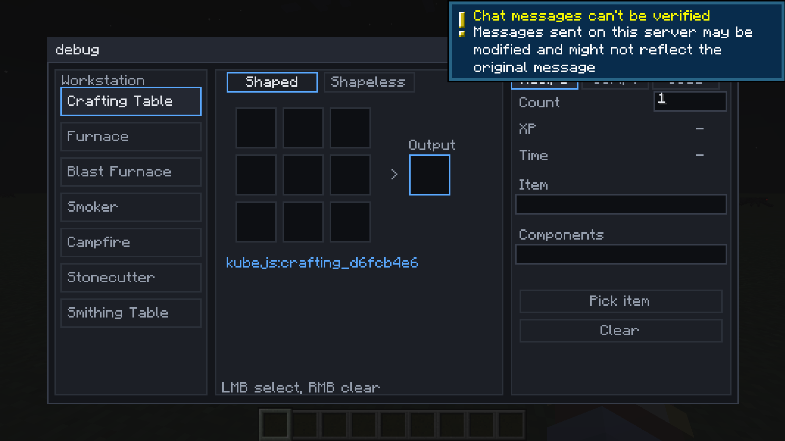
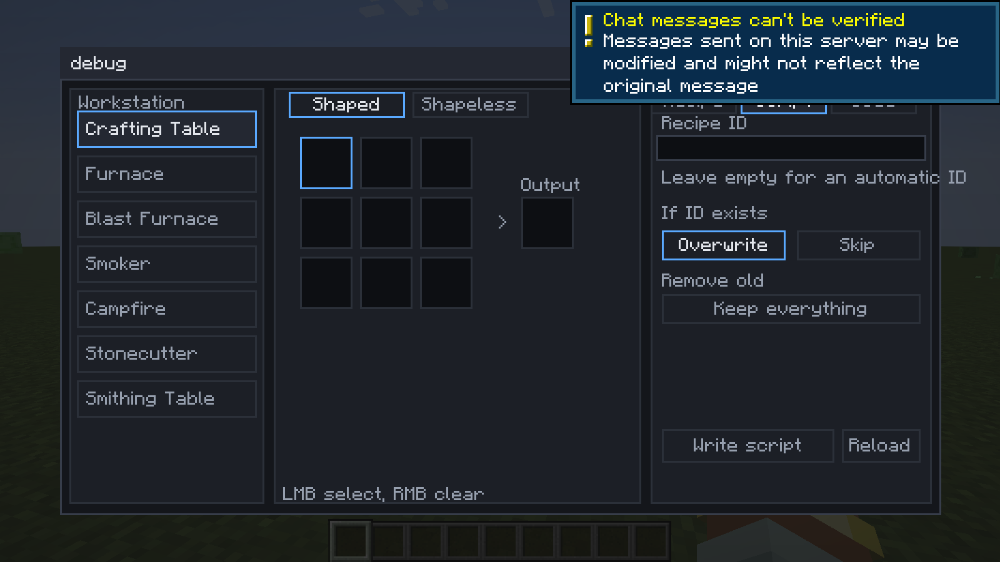
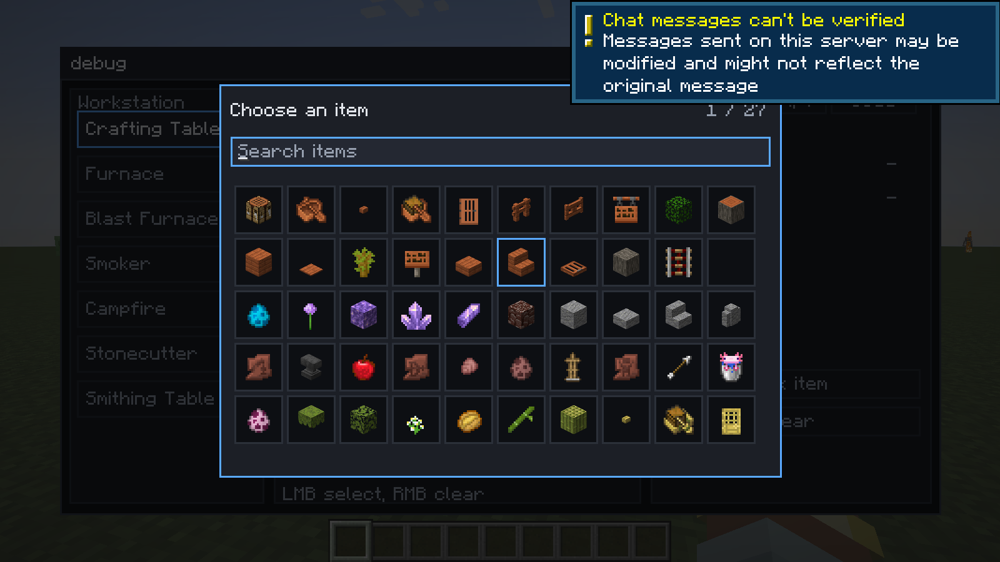
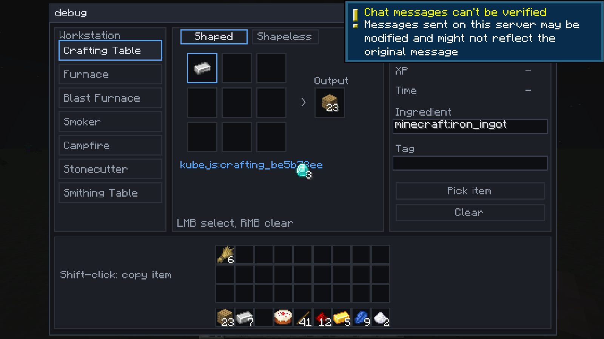

# KubeJS Recipe GUI

A NeoForge mod that adds an intuitive GUI to easily edit KubeJS recipes.

在游戏里放一个「配方编辑器」方块，像工作台一样摆原料、填产出，点一下就把配方写进
`kubejs/server_scripts/generated_recipes.js`；确认无误后点界面上的「重载」按钮即可生效。
不需要手写 JS，也不需要退出游戏。

- Minecraft 1.21.1 / NeoForge 21.1.216+ / Java 21
- 前置：KubeJS 2101.7+（开发与测试使用 2101.7.2-build.381；JEI 可选，用于以后的配方导入）
- 行为约定见 [docs/SPEC.md](docs/SPEC.md)

## 截图









（截图来自开发服务器，右上角的聊天提示是离线测试服的系统提示，不是界面本身。）

## 当前进度

M1 已完成：方块与界面骨架、原版 7 类配方（有序/无序合成、熔炉、高炉、烟熏炉、营火、切石、锻造）、
代码生成与预览、写入脚本与权限控制。

M1 已验证：

- `gradle build` 通过，产物 `build/libs/kubejs_recipe_gui-0.2.0.jar`；
- `RecipeCode` / `ScriptStore` 的 22 个单元测试全部通过；
- 用生成的脚本启动开发服务器，KubeJS 日志为
  `Loaded script server_scripts:generated_recipes.js ... with 0 errors` 与
  `Added 4 recipes, removed 0 recipes ... with 0 failed recipes`；
- KubeJS `2101.7.2-build.381`（当前 1.21.1 分支最新构建）上重跑同一份脚本，日志一致，`0 failed recipes`。

2026-11-01 界面调整（根据实机反馈）：

- 面板从 600×340 缩小到 470×250，GUI 缩放 3 下不再占满屏幕，缩放 4 也能完整显示；
  更小的屏幕会整体等比收缩；
- 输入框获得焦点时按 E 只输入字符，不再关闭界面（退出统一用 ESC）；
- 写入脚本后不再自动 `/reload`，改由「重载」按钮手动触发，避免写完立刻重载造成的卡顿与误操作；
- 输入框改成深色描边样式；配方 ID 直接显示在输出槽下方；标签页与提示文本按面板宽度裁剪，不再溢出。

2026-11-02 界面继续缩小并加入玩家背包（0.2.0）：

- 编辑器面板从 470×250 压到 470×190（工作站按钮、配方区、属性页整体上移），下方接一条
  玩家背包（3×9 主背包 + 快捷栏，走原版 `Slot` 与 `AbstractContainerMenu`）；
- 背包里的物品用原版规则搬运：左键拿起/放下、右键单个、Shift+点击直接把该格物品复制进
  当前选中的原料格或产出格（复制，不消耗背包物品）；
- 界面尺寸从 470×250 变成 470×308，但因为编辑器本体变矮，配方编辑部分比之前更紧凑。

2026-11-02 选择物品浮层修复：

- 物品图标在 GUI 里固定画在 z=100，浮层背景原本在 z=0，导致图标浮在浮层之上；
  现在浮层整体抬到 z=200、浮层里的图标在 z=300、搜索框在 z=400，遮挡关系正确；
- 浮层里补上搜索框的底色与边框，并显示占位提示，网格整体下移不再压住输入框。

## 构建

```bash
./gradlew build -x test      # 打包（测试见下）
./gradlew runClient          # 开发客户端
```

测试用的是纯逻辑代码，不依赖游戏，可以直接用 JUnit 控制台跑（不需要 Gradle 解析测试依赖）：

```bash
javac -encoding UTF-8 -d build/testclasses -cp "build/classes/java/main;<junit-console.jar>" $(find src/test/java -name "*.java")
java -jar <junit-console.jar> execute --class-path "build/classes/java/main;build/testclasses" --scan-class-path
```

离线环境下如果 `runServer` 解析不了 KubeJS 的传递依赖，可以把 KubeJS、Rhino 等 jar 放进 `run/mods/`，
FML 会扫描该目录。

## 结构

```
spec/      配方草稿、原料/产出、写入与删除策略（纯数据）
codegen/   配方 JSON、脚本条目、ID 与校验（纯逻辑）
server/    标记块合并、原子写入脚本文件
network/   客户端 → 服务端的写入请求
client/    配方编辑器界面（原版控件 + 自绘，含底部玩家背包）
```

游戏侧只有 `KubejsRecipeGui`、`ModContent`、`RecipeEditorBlock`、`RecipeEditorMenu`（含 36 个
玩家背包槽位）、`RecipeWriteService` 与界面几个类；其余都是可以直接单测的纯 Java。

## 生成结果长这样

```js
ServerEvents.recipes(event => {
// <kubejs-recipe-gui:begin>
// id: kubejs:crafting_b16949c4
// station: crafting
// output: minecraft:crafting_table
// inputs: minecraft:oak_planks, minecraft:oak_planks, minecraft:oak_planks, minecraft:oak_planks
event.custom({
  "type": "minecraft:crafting_shaped",
  "pattern": [
    "AA",
    "AA"
  ],
  "key": {
    "A": {
      "item": "minecraft:oak_planks"
    }
  },
  "result": {
    "id": "minecraft:crafting_table",
    "count": 1
  }
}).id("kubejs:crafting_b16949c4");
// <kubejs-recipe-gui:end>
})
```

标记块之外的内容不会被改动；同 ID 覆盖、按类型/产物/标签批量删除都在标记块内完成。

## 许可

MIT。
